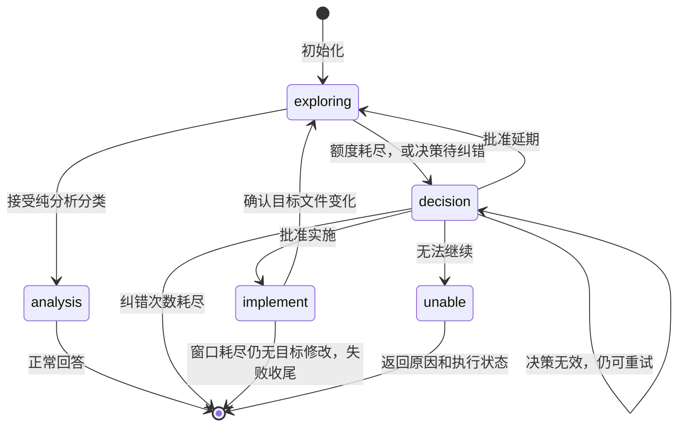

# 探索预算的状态流转

探索预算限制执行实例在作出实施决策前的探索。它与总决策预算共同生效：延期只增加探索额度，不增加总决策预算。普通 ReAct、计划步骤和多代理执行使用该机制；观察器不启用。每个执行实例保存自己的策略和进度。

图中的 `decision` 是运行时的门禁，并非持久化的 `Phase` 值；`analysis` 是任务类型，也不是阶段。实际阶段主要为 `exploring`、`implement` 和 `unable`。模型也可以在额度耗尽前主动提交分类或阶段决策。

## 初始探索和分类

新执行实例从 `exploring` 开始，探索额度为 `initial_turns + extensions × extension_turns`。非分析任务的普通探索轮预扣额度；最后一轮仍可执行，下一轮才触发决策门禁。提交探索决策的轮次会退还预扣的探索额度。总决策预算另行计数。

任务可分类为 `analysis` 或 `modification`，均须提供分类依据。`analysis` 表示用户目标无需修改代码，分类被接受后可继续正常回答，不再受探索额度门禁约束。如果此前已确认修改目标，改判为分析还须提供无需修改的具体证据。

## 额度耗尽后的决策

非分析任务达到额度时，运行时要求独立的探索决策，决策轮禁用工具。处于实施阶段且修改窗口还有剩余时暂缓该门禁。决策可以是：

- **implement**：提供工作区相对路径的目标文件、预期修改、已有证据和下一步操作。获批后进入实施阶段。
- **extend**：提供信息缺口、阻塞原因、调查计划和退出条件。只有延期次数未耗尽、剩余总决策预算足够时才获批；每次获批增加 `extension_turns`。普通情况下回到探索阶段；实施阶段申请延期时保留实施阶段。
- **unable**：提供无法继续的原因和已确认的执行状态，运行时结束执行并返回这些信息。

无效、缺失或违反协议的决策会被拒绝并进入纠错；无效次数超过 `decision_retries` 后停止。实施窗口外的延期拒绝同样使用这份纠错额度。实施窗口内的无效决策则消耗一轮修改窗口，不增加独立纠错额度。

## 实施和修改确认

获批实施后开启 `modification_window_turns` 修改窗口，并记录本次交接的目标。未确认修改前不能重复提交实施决策来刷新窗口；重复交接被拒绝并消耗窗口。有效延期沿用阶段决策的总预算计费，只增加有限探索额度，不刷新同一交接的窗口；缺少必要字段、次数或总预算不足的延期不放行调查。阶段决策必须独立提交，不能夹带工具调用。窗口内的调查仍消耗探索额度；额度已耗尽时，调查及含调查的混合批次整批拒绝，不执行、不登记为工具调用，并保留探索额度和修改窗口。运行时先持久化拒绝原因、可用操作及窗口余量，再让模型纠正调用或单独申请探索延期。保存失败则停止。

实施阶段按获准执行的批次预扣修改窗口；整批工具明确失败时退还该轮额度。失败包括 MCP 工具错误，以及命令已退出且退出码非零（即使 MCP 状态为 success）。部分成功、仍在运行或结果未知的批次不退款；退款状态持久化，恢复不会重复退还。失败调用和纠错所用的模型请求仍计入总决策次数。

运行时对目标文件做批次前后快照，只有确认目标文件内容或存在状态发生变化才能证明本次实施；原有脏内容、测试输出、退出状态和口头声明本身不能证明修改。确认后回到 `exploring`，清空窗口。已确认修改后的识别为验证的操作和完成响应可通过额度门禁；普通调查仍受门禁约束。修改窗口耗尽仍无可确认修改时直接失败收尾。

计费按调用用途区分：含调查的混合批次优先计为探索，额度不足时整批拒绝，不能部分执行修改或验证；有额度时单批次只计一轮探索。已识别的修改与验证有各自处理。进程轮询、停止和结果读取继承原调用用途，无法识别的调用保守地视为调查。支持的验证和修改命令范围以实现中的分类规则为准。

## 配置和恢复

| 配置项 | 默认值 | 含义 |
| --- | ---: | --- |
| `initial_turns` | 12 | 初始探索额度 |
| `decision_retries` | 1 | 无效阶段决策允许的纠错次数 |
| `extension_turns` | 4 | 每次获批延期增加的额度 |
| `max_extensions` | 2 | 最多获批延期次数 |
| `modification_window_turns` | 3 | 每次实施交接的修改窗口 |

配置可在 `base.exploration_budget` 设置，并由对应 agent 的配置逐项覆盖。初始额度、每次延期额度和修改窗口必须为正数；重试次数和最大延期次数可以为零。

进度和策略随执行状态持久化；恢复同一执行实例时沿用已保存的策略、计数、交接和证据，新连接不会继承旧进程的会话身份。新执行实例使用自己的预算。总决策预算耗尽也会终止执行，即使探索额度仍有剩余。

实现入口见 [exploration.go](../internal/agent/exploration.go)、[base_react.go](../internal/agent/base_react.go)、[exploration_modification.go](../internal/agent/exploration_modification.go) 和 [配置定义](../internal/config/agent.go)。

## 工作区检查

实施阶段即使探索额度耗尽，也允许执行有限白名单内的 `git status`。用途记为 `workspace_check`，不消耗探索额度，但同一业务批次消耗一轮修改窗口。窗口耗尽仍无可确认的目标变化时失败收尾。

准备 `apply_patch` 时，可用 `grep` 查找交接目标中的锚点，再用 `read_file` 读取附近源码。每个调用须显式指定 `target_files` 中的单个工作区相对文件路径。符合范围的调用读取当前源码，按 `workspace_check` 计费。每个获准批次消耗一轮修改窗口，整批明确失败时退还。未指定路径、面向目录的常规搜索以及读取或搜索其他文件仍按调查计费。即使目录或符号链接被列入交接目标，实施定位调用也会报错。

支持无参数的 `git status`，以及以下选项的组合：`-s` / `--short`、`-b` / `--branch`、`--long`、`--show-stash`、`-z` / `--null`、`--porcelain` / `--porcelain=v1` / `--porcelain=v2` / `--porcelain=1` / `--porcelain=2`、`-uno` / `-unormal` / `-uall`、`--untracked-files=no` / `--untracked-files=normal` / `--untracked-files=all`。其他参数、全局 Git 选项、路径参数、复合命令和脚本仍保守归为调查。

检查结果、成功退出和已有未提交变更都不构成本次修改证据。`git diff` 仍只对本实例已确认目标变更的精确路径核验沿用验证规则；全仓、历史和无法识别的 diff 仍为调查。

实施阶段每轮在上下文最后追加独立的 user 消息，位于工具历史、状态正文和纠错消息之后：明确剩余修改窗口，要求依据已有证据优先对目标文件执行下一项修改，必要时检查工作区，存在阻塞时单独申请探索延期或返回 unable，修改后执行验证。提示随当前窗口重建，确认修改退出实施阶段后不再追加。

恢复实施阶段时，模型上下文显式包含原交接的目标、证据、下一步操作、探索消耗、延期次数和剩余修改窗口；存在拒绝时同时提供原拒绝原因。配置变化不会刷新已保存的策略或额度。恢复日志包含拒绝上下文，已确认的检查与工具结果按原执行实例恢复，不自动重放；被拒绝的调查不会成为已执行工具记录。窗口已耗尽、总预算耗尽或工具结果未知时继续遵循原停止边界。

### 交接前完成修改

交接前的 `apply_patch` 和受支持的简单 `sed -i` 修改也记录候选文件的批次前后快照。只有已知结果中的实际文件变化才成为本执行实例的修改证据；既有脏内容、未知结果和测试生成的文件不能替代修改证据。恢复仅使用落盘的快照与工具记录，不从当前工作区反推历史修改。

已有修改证据后，允许在预算阈值执行受支持的验证并正常返回 `completed`。未建立实施交接的预算阈值完成路径要求最近一次修改之后的最近一批验证结果明确且退出码为零，不能用较早的成功掩盖后续失败或未知结果。验证失败、运行中、结果未知或只有模型声明时不能完成。

`implement.next_operation` 必须描述接下来执行的修改操作；包含“无需操作”“返回最终结果”等否定操作或结束声明时拒绝并要求纠正。已完成修改和验证应使用正常完成协议，无须制造额外修改。
